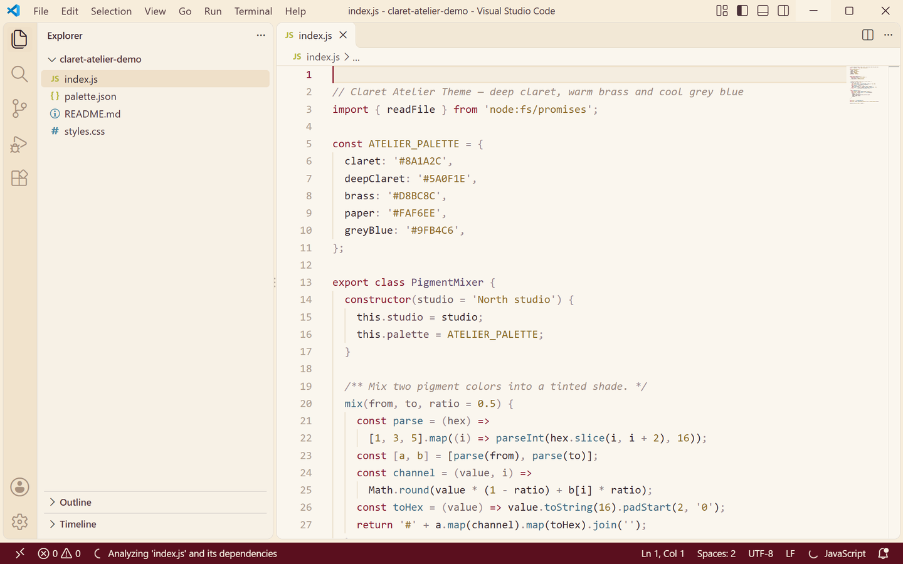
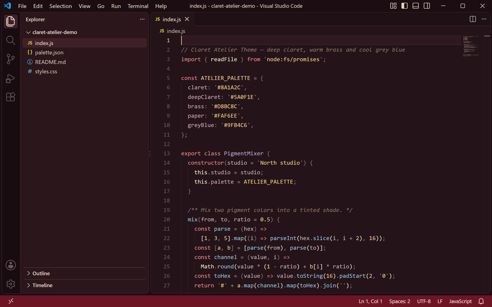

<p align="center">
  
</p>

<h1 align="center">Claret Atelier Theme</h1>

<p align="center">
  <a href="https://marketplace.visualstudio.com/items?itemName=lilinhuang.claret-atelier-theme"></a>
  
  
  <a href="https://github.com/vaxicy/claret-atelier-theme/blob/main/LICENSE"></a>
</p>

A painter's studio theme: **paper white canvas with deep claret and warm brass** in the light variant, and a **candlelit pigment room** in the dark one. Both variants share one palette, so switching changes the lighting, not the studio.

一套画室配色主题：浅色版是**纸白画布**配深酒红与暖铜金，深色版是**烛光下的颜料间**。明暗两版共用同一套色板，切换时变的是光线，不是画室。

## Preview / 预览

| Light 浅色 | Dark 深色 |
| --- | --- |
|  |  |

> Both previews are captured from a real VS Code window running the theme — no mockups.
>
> 上方预览图取自真实运行该主题的 VS Code 窗口截图，非模拟图。

## Palette / 色板

| Role | Light | Dark |
| --- | --- | --- |
| Editor background | `#FAF6EE` paper white | `#241318` pigment room |
| Foreground | `#3A2A30` ink brown | `#EFE3D6` warm paper |
| Muted text / placeholders | `#8C7A80` | `#A09098` |
| Side bar | `#F7F1E6` with `#4A3038` text | `#2A161B` with `#DCC9BF` text |
| Panel / terminal | `#F9F3E9` | `#201115` |
| Title bar | `#F7EDDB` with `#4A3038` text | `#1B0D11` with `#E3D5C6` text |
| Tab bar / inactive tab | `#F2E8D6` | `#1E1014` |
| Active tab / indicator | `#3A2A30` text, `#8A1A2C` top border | `#F2E6DA` text, `#D8BC8C` top border |
| Activity bar | `#F1E3CC` with `#5A0F1E` icons | `#180C10` with `#C98A92` icons |
| Status bar | `#5A0F1E` with `#F5EFE1` text | `#6E1524` with `#F0E4D6` text |
| Selection | `#E7D3BA` brass wash | `#4E2129` |
| Current line | `#F4EDE0` | `#301820` |
| Borders | `#E7DCC9` | `#402630` |
| Indent guides | `#E8DCC7` | `#362026` |
| Button | `#8A1A2C` with `#FAF6EE` text (hover `#A02436`) | `#D8BC8C` with `#2A1218` text (hover `#EBD3A6`) |
| Badge | `#5A0F1E` with `#F5EFE1` text | `#8A1A2C` with `#F5EFE1` text |
| Cursor | `#8A1A2C` | `#D8BC8C` |
| Links | `#5A0F1E` | `#E0B9C0` |
| Errors / warnings | `#B3414B` / `#9A6A18` | `#F0929A` / `#E8C86E` |
| Git added / modified / deleted | `#3E7A52` / `#9A6A18` / `#B3414B` | `#8FC9A0` / `#E8C86E` / `#F0929A` |

Claret `#8A1A2C`, deep claret `#5A0F1E`, brass `#D8BC8C`, paper `#FAF6EE` and grey blue `#9FB4C6` carry both variants, so a file still reads as "claret atelier" after switching.

酒红 `#8A1A2C`、深酒红 `#5A0F1E`、铜金 `#D8BC8C`、纸白 `#FAF6EE` 与灰蓝 `#9FB4C6` 贯穿明暗两版，切换后整个文件还是同一间画室。

## Syntax mapping / 语法映射

| Syntax | Light | Dark |
| --- | --- | --- |
| Comments | `#9C8A7E` | `#8E7A6E` |
| Keywords / storage | `#8A1A2C` | `#E48A92` |
| Strings | `#8F6B2A` | `#E8CE92` |
| Functions / methods | `#3F6B84` | `#9CC3DC` |
| Types / classes | `#5F4A6E` | `#BCA7CC` |
| Numbers / constants | `#8A6A24` | `#E8CE92` |
| Variables | `#3A2A30` | `#EFE3D6` |
| Parameters | `#6E5A60` | `#C3B2BA` |
| Properties | `#6B4A55` | `#C9A8B4` |
| Operators | `#8A7A80` | `#A8969E` |
| Punctuation | `#9C8A90` | `#8E7A82` |
| HTML tags | `#8A1A2C` | `#E48A92` |
| Attribute names | `#8A6A24` | `#E8CE92` |
| Regex | `#A65A32` | `#E8A87C` |
| Escape characters | `#8A6A24` | `#E8CE92` |

Semantic highlighting is enabled, so variables, parameters, properties, functions and types follow the same mapping in TypeScript, JavaScript, Go, Rust and Python.

已开启语义高亮，TypeScript、JavaScript、Go、Rust 与 Python 里的变量、参数、属性、函数与类型都会落到同一套配色。

## Install / 安装

Search **Claret Atelier Theme** in the Extensions view, then pick `Claret Atelier Theme Light` or `Claret Atelier Theme Dark` from the theme picker (`Ctrl+K Ctrl+T`).

在扩展面板搜索 **Claret Atelier Theme**，安装后用 `Ctrl+K Ctrl+T` 在 `Claret Atelier Theme Light` 与 `Claret Atelier Theme Dark` 之间选择。

```bash
code --install-extension lilinhuang.claret-atelier-theme
```

## Build from source / 本地构建

```bash
py -3 scripts/build-theme.py       # regenerate both theme JSON files
py -3 scripts/generate-icon.py     # export assets/icon.png from the selected logo
py -3 scripts/capture-real-screenshots.py   # real VS Code screenshots
```

## License / 许可证

Non-Commercial License — free for personal, educational and non-commercial use. See [LICENSE](https://github.com/vaxicy/claret-atelier-theme/blob/main/LICENSE).

非商业许可证：个人、教育与非商业用途免费使用，详见 LICENSE。
